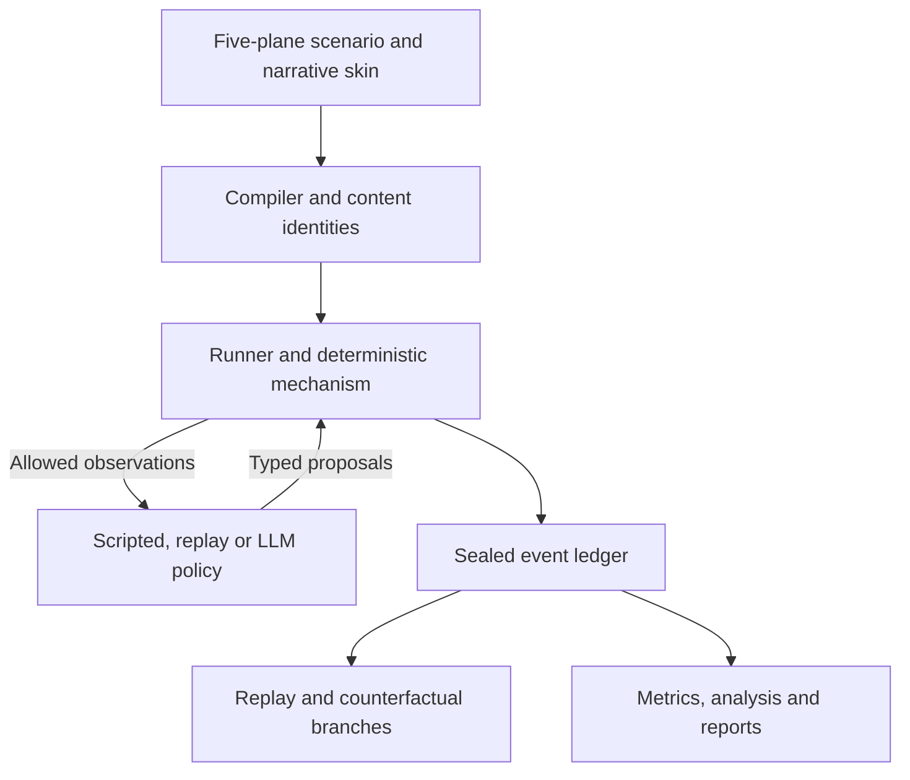

# Collaborative Hill Lab

*A reproducible laboratory for cooperation, shared evidence and mixed incentives.*

**Research question:** which interaction structures, information structures and
institutional mechanisms help heterogeneous agents sustain accurate, useful
cooperation? The long-term target is LLM-agent populations. The current evidence
comes from scripted agents in deterministic, synthetic environments.

The project starts from Cristian Tcaci and Chris Huyck's N-person Iterated
Prisoner's Dilemma lineage, then tests its assumptions and extends the laboratory
to **Evidence Commons**: agents contribute, share and verify evidence under
different accountability and information rules.

## Current capabilities — 2026-10-29

- **Reproducible engine.** Typed five-plane scenarios, exact-fraction payoffs,
  hierarchical seeds, hash-linked sealed ledgers, replay, checkpoint branching and
  read-only counterfactual comparison. Narrative skins cannot change the rules.
- **Two mechanisms.** N-IPD supports pairwise and neighbourhood interaction;
  Evidence Commons v0 supports provenance, budgets and a 2×2 institutional design.
- **Three studies.** Study 000 reproduces and deconfounds the legacy claims.
  Study 001 is an executable, unfrozen Evidence Commons draft. Study 002 adds an
  executed N=3/N=5 threshold and pTFT denominator sensitivity experiment.
- **Analysis with explicit assumptions.** `chl analyze` reads sealed episodes,
  rejects conflicting retries and non-treatment confounds, and supports independent
  or explicitly paired designs. A standalone incentive atlas derives exact
  finite-strategy constraints. Study 002 includes exact finite-population pTFT
  benchmarks alongside the measured results.
- **Persistent verification.** GitHub Actions tests each exact PR head and `main`
  commit, including the complete suite, all shipped study definitions, acceptance
  scenarios and reproducible standalone research outputs. Inputs reject unsafe
  output paths, invalid execution counts and misspelled built-in policy parameters.

The LLM policy adapter has typed actions, bounded retries and safe abstention, with
offline fake-provider tests. A real provider transport and live pilot remain
[planned work](NEXT.md). No real model call or human-subject experiment supports
the current findings.

## What the experiments establish

| Work | Finding and boundary | Readout |
|---|---|---|
| Study 000 | The legacy pattern depends on both interaction structure and reciprocity rule; targeted and linked TFT behave differently even on the same pairwise structure. This reproduces claims, not the defective legacy artifacts. | [Replication report](docs/research/REPLICATION_REPORT.md) |
| Study 001 | Current placeholder weights pass free-riding temptation (C1) but fail collective stakes (C2). The configured social dilemma is **not certified**. Same-action institutional integrity (C3) passes. | [Study draft](studies/001-evidence-commons/README.md) |
| Incentive atlas | For the enumerated contributor/freerider strategies, the common strict C2 region is `b + 7r > 39`, with nonnegative benefit and credit multipliers. This does not choose weights or establish a behavioral benefit. | [Methods and constraints](experiments/incentive-atlas/README.md) |
| Study 002 | All 29 deterministic trajectories and score vectors match their predictions. The inclusive quorum boundary is `(m−1)/(N−1)`, so population composition matters. Six pTFT cells retain all 192 independent episode results, including a finite-sample bootstrap discrepancy. | [Measured results](studies/002-nipd-sensitivity/RESULTS.md) |
| Exact pTFT benchmark | A finite-state model derives means, variances and absorption probabilities for the ideal rational Bernoulli process. It explains why positive late cooperation expectations can coexist with all-zero observed final windows. | [Post hoc benchmark](studies/002-nipd-sensitivity/EXACT_PTFT_BENCHMARK.md) |

## Install and verify

From a checkout, using Python 3.12 or later:

```bash
make setup
make doctor
make check test validate acceptance check-atlas check-study002
```

`make setup` installs the committed `requirements-lock.txt`, builds the editable
package using the pinned backend without build isolation, and runs `pip check`.
It does not rewrite the lock. Setup downloads dependencies; the subsequent science
checks use synthetic data and no model provider. CI currently verifies Ubuntu
24.04 with Python 3.12; this is not a cross-platform test matrix or network sandbox.

Make selects `.venv/bin/python` on POSIX and `.venv/Scripts/python.exe` on Windows
(run make from Git Bash). Use `make setup PYTHON="/path/to/python"` to select the
interpreter. Without make, run that virtual environment's Python with the exact
commands in [Makefile](Makefile); activating the environment also exposes `chl`.

## Run an experiment

### N-IPD sensitivity, including measured output

```bash
make study-002-plan
make study-002
```

The first command validates and prints the 221-episode plan without running it.
The second runs both declared components and writes `report.md` and `report.json`
under `artifacts/study-002`. Existing run outputs are protected. For a rerun, choose
a fresh directory:

```bash
make study-002 STUDY002_ARTIFACTS=artifacts/study-002-repeat
```

`make check-study002` checks canonical input bytes, types the study modules and
reproduces the checked-in exact benchmark and figure without changing evidence.
See the [study methods](studies/002-nipd-sensitivity/README.md) for direct commands,
the sampling plan and the distinction between local pre-execution predictions
and the later published source snapshot.

### Other engine workflows

```bash
make study-000       # 330 legacy/deconfound episodes and replication report
make study-001-smoke # scripted Evidence Commons fixture and certificate
make replay-smoke   # re-execute a sealed run and compare the hash chain
make report         # derive run/study reports from generated artifacts
```

The [counterfactual guide](docs/COUNTERFACTUAL_WORKFLOW.md) demonstrates parent,
child and grandchild runs, replay and `chl compare`. The
[analysis input contract](docs/research/ANALYSIS_INPUT_VALIDATION.md) explains
which artifacts `chl analyze` accepts and when it withholds inference. The
[study input contract](docs/STUDY_INPUTS.md) explains validation and output safety.

Inspect seeds before running, with the environment active:

```bash
chl study audit-seeds studies/001-evidence-commons --replicate 0 --round 0
```

This read-only audit includes the study identity, protocol, declared blocks and
kernel seed paths. Matching streams do not establish scientific comparability,
paired provider randomness or reduced variance.

## Architecture



The mechanism controls world truth, legality and payoffs. Policies see only allowed
observations; scorers do not influence live execution. Decisions and rationale are
in [ADRs 0001–0009](docs/adr/) and the [foundation review](docs/FOUNDATION_REVIEW.md).

## Scientific limits

All current measured results concern the specified scripted populations and
mechanisms. They do not establish LLM behavior, human behavior or policy outcomes.
Evidence Commons v0 verifies provenance through the engine; agents cannot yet
falsify verification outcomes. The contributor/freerider baselines do not respond
to attribution or utility weights, so incentive inequalities alone cannot
demonstrate institutional improvement.

Study 002 is an unfrozen exploratory sensitivity analysis. Agents and rounds are
not independent replicates. A zero observed variance does not prove a zero
population variance. Its exact pTFT mathematics describes an ideal rational
Bernoulli process; the unchanged simulator samples using finite-precision PRNG
draws and floating-point probability ratios. Replay reproduces recorded actions
and deterministic world transitions, not an LLM's cognition or provider sampling.

Hash links verify consistency relative to a retained commitment; they are not
authentication against an author who can replace every artifact. The full
[claims and limitations](docs/research/CLAIMS_AND_LIMITATIONS.md), study methods
and current [handoff](HANDOFF.md) retain the remaining qualifications.

## Repository map

| Path | Contents |
|---|---|
| `src/collaborative_hill/` | Engine, domain models, policies, experiments, metrics, reporting and CLI |
| `studies/000-legacy-reproduction/` | Legacy reproduction and policy/structure deconfound |
| `studies/001-evidence-commons/` | Unfrozen 2×2 draft, skins, certificate, preregistration and cost worksheet |
| `studies/002-nipd-sensitivity/` | Canonical sensitivity design, runner, measured results, exact benchmark and provenance |
| `experiments/incentive-atlas/` | Exact finite-strategy incentive-region exploration |
| `docs/adr/`, `docs/research/` | Architecture decisions, methods, research context and analysis contract |
| `tests/`, `.github/workflows/ci.yml` | Unit, property, metamorphic and integration checks; persistent CI |
| `artifacts/` | Generated sealed runs and reports, ignored by Git |

Contributor guide: [AGENTS.md](AGENTS.md). Operating rules: [CLAUDE.md](CLAUDE.md).
Current checkpoint: [HANDOFF.md](HANDOFF.md). Direction and milestones:
[NEXT.md](NEXT.md), [PLAN.md](PLAN.md).

## License

Current releases use GNU GPL version 3 only (`GPL-3.0-only`); see [LICENSE](LICENSE).
Versions published before 12 August 2026 retain their existing MIT grant; see
[RELICENSING.md](RELICENSING.md) and [LICENSES/MIT.txt](LICENSES/MIT.txt).
