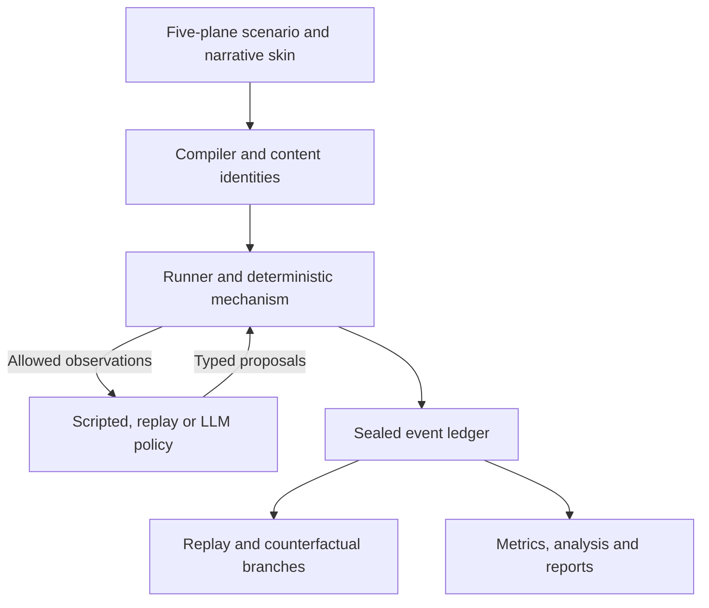

# Collaborative Hill Lab

*A reproducible laboratory for cooperation, shared evidence and mixed incentives.*

**Research question:** which interaction structures, information structures and
institutional mechanisms help heterogeneous agents sustain accurate, useful
cooperation? The long-term target is LLM-agent populations. The current evidence
comes from scripted agents in deterministic, synthetic environments.

The project starts from Cristian Tcaci and Chris Huyck's N-person Iterated
Prisoner's Dilemma lineage, then tests its assumptions and extends the laboratory
to **Evidence Commons**: agents contribute, share and verify evidence under
different accountability and information rules.

**Current development goal:** connect the existing experiments into one offline
workflow: discover a question, plan and run it into fresh output, monitor its
artifacts, inspect individual rounds, and verify its source record. Start with the
[lab walkthrough](docs/LAB_WALKTHROUGH.md). The [roadmap](ROADMAP.md) separates
active engineering, the next declared research question and owner scientific
decisions; [NEXT.md](NEXT.md) is the short working queue.

The curated [issue seeds](scripts/issue_seeds.json) carry concrete acceptance
criteria. `python scripts/seed_issues.py --check` validates them offline;
`--remote` previews missing work against both open and closed issues. Publication
is explicit, and completed issues are never reopened by the seeder.

## Current capabilities — 2026-11-05

- **Connected experiment workflow.** `chl catalog` indexes all shipped studies and
  experiment packs with source records, evidence status and available operations.
  `chl experiment plan|run|check` exposes the existing runners with inspectable
  plans and fresh output directories. Start with the
  [graph experiment walkthrough](docs/LAB_WALKTHROUGH.md).
- **Artifact health and round inspection.** `chl monitor TARGET --json` separates
  completed, failed, unsealed and broken artifacts. `chl lab` exports a standalone
  inspector with run/agent/round navigation, recorded observations, actions,
  graph interactions and released audit reports. State hashes and branch context
  remain visible; unsealed artifacts do not establish process liveness.

- **Reproducible engine.** Typed five-plane scenarios, exact-fraction payoffs,
  hierarchical seeds, hash-linked sealed ledgers, replay, checkpoint branching and
  read-only counterfactual comparison. Recorded seed metadata is validated before
  replay or branch output. Narrative skins cannot change the rules.
- **Versioned mechanisms.** Legacy N-IPD retains its complete-population pairwise
  and neighbourhood rules. `nipd_graph` adds explicit undirected graphs, local
  observations and sum/mean edge payoffs. Evidence Commons v0 supports provenance,
  budgets and a 2×2 institutional design.
- **Three studies.** Study 000 reproduces and deconfounds the legacy claims.
  Study 001 is an executable, unfrozen Evidence Commons draft. Study 002 adds an
  executed N=3/N=5 threshold and pTFT denominator sensitivity experiment.
- **Analysis with explicit assumptions.** `chl analyze` reads sealed episodes,
  rejects conflicting retries and non-treatment confounds, and supports independent
  or explicitly paired designs. A standalone incentive atlas derives exact
  finite-strategy constraints. Study 002 includes exact finite-population pTFT
  benchmarks alongside the measured results.
- **Observation-responsive EC baseline.** A versioned conditional contributor
  uses visible contribution history. Its finite sensitivity experiment keeps
  beneficial, harmful and null accountability contrasts, alongside separate
  incentive and same-action integrity checks.
- **Separated evidence-rule components.** A versioned ablation policy independently
  switches screening, contradiction sharing, challenges and citation reading. A
  separate exact noisy-corpus model tests declared independent and correlated
  source errors. Both retain their pre-execution predictions and complete outcomes.
- **Opt-in public audits.** A separate EC v3 mechanism publishes the versioned
  `ec-audit-observation@1` envelope before observations, with exact declared error
  and unavailability laws and isolated target streams. A new scripted negative-veto
  policy responds to findings. Existing EC v2 inputs, policies and replay hashes
  remain unchanged. See [audit configuration and limits](docs/AUDIT_USAGE.md).
- **Explicit audit-aware prompts.** `prompt_renderer="ec-audit@1"` exposes validated,
  released public findings to fake or compatible LLM providers under a distinct
  template and policy identity. The default `legacy@1` keeps its original prompt
  bytes and identities. [Configuration and offline scope](docs/PROVIDER_USAGE.md#opt-in-audit-aware-evidence-commons-prompts).
- **Configurable provider transport.** An optional OpenAI-compatible Chat
  Completions adapter records requested/reported models and measured request
  usage. Explicit execution opt-in, bounded retries, redacted errors and
  continuation accounting are covered by offline HTTP fixtures.
- **Provider request limits.** `chl study plan` shows worst-case completions and HTTP
  attempts offline. An explicit cumulative attempt budget charges each attempt before
  sending; a stop seals `RunFailed` and replays offline. Budgeted continuations require the
  same explicitly supplied budget object, and analysis retains stable stop reasons.
  Abrupt process termination does not establish final request accounting. No default
  limit is implied.
- **Fast, visible feedback.** `make quick` selects checks from the diff, `chl lab` shows
  per-agent film strips from verified ledgers, `make mutants` samples test gaps, and a
  Hypothesis fuzzer checks whole-episode invariants on random small scenarios.
  The console validates scenario and branch provenance, labels continuation policies
  and inherited actions, and separates branches even when their default run IDs match.
  `make lab` includes clearly labeled Study 002 and audit-feedback inspection samples.
- **Persistent verification.** GitHub Actions tests each exact PR head and `main`
  commit on Ubuntu and Windows, including the complete suite, all shipped study definitions, acceptance
  scenarios and reproducible standalone research outputs. Inputs reject unsafe
  output paths, invalid execution counts and misspelled built-in policy parameters.
  The Ubuntu job also exercises the inspector in Chrome at desktop and mobile
  widths and retains screenshots and DOM snapshots for review.

No live provider call or human-subject experiment supports the current findings.
The provider integration is implemented and tested offline; model selection, a live pilot and its
scientific design remain open. See [provider usage](docs/PROVIDER_USAGE.md) for the
execution boundary and [current priorities](NEXT.md) for the remaining work.

## What the experiments establish

| Work | Finding and boundary | Readout |
|---|---|---|
| Study 000 | The legacy pattern depends on both interaction structure and reciprocity rule; targeted and linked TFT behave differently even on the same pairwise structure. This reproduces claims, not the defective legacy artifacts. | [Replication report](docs/research/REPLICATION_REPORT.md) |
| Study 001 | Current placeholder weights pass free-riding temptation (C1) but fail collective stakes (C2). The configured social dilemma is **not certified**. Same-action institutional integrity (C3) passes. | [Study draft](studies/001-evidence-commons/README.md) |
| Incentive atlas | For the enumerated contributor/freerider strategies, the common strict C2 region is `b + 7r > 39`, with nonnegative benefit and credit multipliers. This does not choose weights or establish a behavioral benefit. | [Methods and constraints](experiments/incentive-atlas/README.md) |
| Study 002 | All 29 deterministic trajectories and score vectors match their predictions. The inclusive quorum boundary is `(m−1)/(N−1)`, so population composition matters. Six pTFT cells retain all 192 independent episode results, including a finite-sample bootstrap discrepancy. | [Measured results](studies/002-nipd-sensitivity/RESULTS.md) |
| Exact pTFT benchmark | A finite-state model derives means, variances and absorption probabilities for the ideal rational Bernoulli process. It explains why positive late cooperation expectations can coexist with all-zero observed final windows. | [Post hoc benchmark](studies/002-nipd-sensitivity/EXACT_PTFT_BENCHMARK.md) |
| Responsive EC | The 320 deterministic behavioral episodes give 160 matched contrasts: quality rises in 2, falls in 2 and is unchanged in 156. All 160 separate same-action replays preserve briefing, effort, quality and total utility. These are exact findings for the declared finite grid. | [Results and source record](experiments/responsive-commons/RESULTS.md) |
| Quality safeguards | Across 220 accurate/misleading pairs the skeptical rule acts identically with opposite quality, so it cannot separate truth from unanimous false support. On conflicted evidence it trades: it gains where structure tracks truth and loses where structure inverts it. For its two designated strategies and placeholder settings, C1 and C2 hold together in 0 of 48 groups. | [Results](experiments/quality-safeguards/RESULTS.md) |
| EC component ablation | 192 behavioral episodes and 96 fixed-action controls isolate four independently switched components. All P1–P6 predictions hold and 288 ledger replays match. Sharing, challenges and screening interact; the citation-read gate acts in the limited-inspection probe. All 96 truth pairs retain identical actions and observations. | [Ablation readout](experiments/ec-rule-ablation/RESULTS.md) |
| Declared noisy corpora | 64 behavioral episodes and 64 accounting controls satisfy P1–P8. With independent errors, skepticism can improve accuracy among accepted claims while reducing coverage and signed quality. Fully correlated errors give a null rule contrast with distinct labels. These are synthetic assumptions, not estimated source reliability. | [Exact expectations](experiments/noisy-corpus/RESULTS.md) |
| Audit feedback | All P1–P8 hold across 76 sealed runs, 60 fixed-action comparisons and 720 exact expectation rows. Early negative findings can improve selective accuracy while lowering coverage and signed quality. Their exact quality contrast is `12(1-u)(a+e-1)` under the declared correlated-source model; late findings have separate effort and null controls. | [Audit readout](experiments/audit-feedback/RESULTS.md) |
| Sparse exact pTFT | Sixteen exact cells on small graphs match an independent history oracle, and the Study 002 benchmark on complete graphs. Total cooperator count is not a sufficient state on the four-cycle. No topology ranking follows. | [Readout](experiments/sparse-ptft/EXACT.md) |
| Graph topology controls | All 18 eight-round cooperation curves match their pre-execution predictions, and all sealed runs replay. The N=5 design fixes one AllD and mean edge payoff while separating complete/ring/star topology, defector placement and reciprocity rule. | [Exact readout](experiments/graph-topology/RESULTS.md) |

## Install and verify

From a checkout, using Python 3.12 or later:

```bash
make setup
make doctor
make check test validate acceptance check-atlas check-study002 check-responsive check-quality-safeguards check-graph check-sparse-ptft check-noisy-corpus check-ec-rule-ablation check-audit-feedback
```

`make setup` installs the committed `requirements-lock.txt`, builds the editable
package using the pinned backend without build isolation, and runs `pip check`.
It does not rewrite the lock. Setup downloads dependencies; the subsequent science
checks use synthetic data and no model provider. The CI matrix uses Ubuntu and
Windows with Python 3.12; it does not cover macOS, multiple Python versions or
live providers. Exact-head verification and merge records are in
[HANDOFF.md](HANDOFF.md).

Make selects `.venv/bin/python` on POSIX and `.venv/Scripts/python.exe` on Windows
(run make from Git Bash). Use `make setup PYTHON="/path/to/python"` to select the
interpreter. Without make, run that virtual environment's Python with the exact
commands in [Makefile](Makefile); activating the environment also exposes `chl`.
Use the virtual environment's Python for the direct commands below, or activate it first.

## Run an experiment

### N-IPD sensitivity, including measured output

```bash
make study-002-plan
make study-002
```

The first command validates and prints the 221-episode plan without running it.
The second runs both declared components and writes `report.md` and `report.json`
under `artifacts/study-002`. Existing run outputs are protected. For a rerun, choose
a fresh directory:

```bash
make study-002 STUDY002_ARTIFACTS=artifacts/study-002-repeat
```

`make check-study002` checks canonical input bytes, types the study modules and
reproduces the checked-in exact benchmark and figure without changing evidence.
See the [study methods](studies/002-nipd-sensitivity/README.md) for direct commands,
the sampling plan and the distinction between local pre-execution predictions
and the later published source snapshot.

### Responsive Evidence Commons

```bash
python experiments/responsive-commons/responsive_commons.py --out artifacts/responsive-new
make check-responsive
```

The first command requires a fresh directory and retains the 320 behavioral runs,
160 controlled replays, inputs, readout and execution source record. The check
regenerates the complete grid in a temporary directory and compares the committed
JSON and Markdown byte for byte. The [design](experiments/responsive-commons/DESIGN.md)
fixes both accurate and misleading corpora, all five policy rules and all eight
labeled active/freerider profiles; no cell is selected by its outcome.

### Evidence-rule components and declared source noise

```bash
python experiments/ec-rule-ablation/ec_rule_ablation.py --out artifacts/ec-ablation-new
make check-ec-rule-ablation
python experiments/noisy-corpus/noisy_corpus.py --out artifacts/noisy-corpus-new
make check-noisy-corpus
```

Each execution requires clean committed source and a fresh output directory.
The ablation retains all 16 component combinations in six contexts under both
hidden truths. The noisy-corpus experiment reweights the same 64 finite outcomes
at six declared error rates; those weights are not additional samples. Each gate
checks standalone code, regenerates the declared sealed runs, replays every
regenerated chain and compares the retained readouts byte for byte. The original
raw-run archive receives a separate integrity audit. Published source mappings
preserve the actual original clean execution commits and their equal public source trees.

The [audit contract](docs/adr/0017-noisy-corpus-and-audit-contract.md) is separate
from these historical experiments. Its opt-in engine integration is described
in [ADR-0018](docs/adr/0018-opt-in-evidence-commons-audits.md) and the
[audit usage guide](docs/AUDIT_USAGE.md); it does not alter those original runs.

### Audit feedback: timing, accuracy and unavailable reports

```bash
python experiments/audit-feedback/audit_feedback.py --out artifacts/audit-feedback-new
make check-audit-feedback
```

The first command requires clean committed source and a fresh destination. It
retains 52 behavioral runs, 24 fixed-action controls, four separate branch
fixtures and complete prediction checks. The gate regenerates those cases,
replays every ledger and byte-compares the readout. Its 720 expectation rows
reweight conditional trajectories under explicit laws; they are not additional
samples. The [design](experiments/audit-feedback/DESIGN.md) and complete source
were published before the original execution. See the
[methods and provenance](experiments/audit-feedback/README.md).

### Local graph N-IPD

```bash
python experiments/graph-topology/graph_experiment.py --check
python experiments/graph-topology/graph_experiment.py --run --artifacts artifacts/graph-topology-new
```

The graph fixture declares eight rounds and one deterministic episode per cell.
The [original readout](experiments/graph-topology/RESULTS.md) retains all 18 curves,
scores and prediction comparisons, including complete defection in several cells.
The run command requires a fresh artifact root, records its source inputs,
independently replays every run, and writes an exact readout. To derive another
readout from those original artifacts, use `--report-from <artifact-root>` with
`--output <fresh-prefix>`; a new execution is separate evidence. The
[graph guide](experiments/graph-topology/README.md) explains the different vote
denominators, hub/leaf placement and complete-graph equivalence controls.

### Configured provider execution

Validation and recorded-action replay stay offline. A study or continuation using
`llm_openai_compatible` needs the explicit `--allow-provider-requests` flag;
selected credentials are checked before execution creates artifacts or makes a
request. Model, endpoint, token cap and any credential environment-variable name
come from the declared configuration. The flag enables execution; the existing
human-owned model, budget and study decisions still apply. See the
[provider guide](docs/PROVIDER_USAGE.md) for the supported configuration and
honest handling of unknown usage. Repository verification makes no live calls.

### Other engine workflows

```bash
make study-000       # 330 legacy/deconfound episodes and replication report
make study-001-smoke # scripted Evidence Commons fixture and certificate
make replay-smoke   # re-execute a sealed run and compare the hash chain
make report         # derive run/study reports from generated artifacts
```

The [counterfactual guide](docs/COUNTERFACTUAL_WORKFLOW.md) demonstrates parent,
child and grandchild runs, replay and `chl compare`. The
[analysis input contract](docs/research/ANALYSIS_INPUT_VALIDATION.md) explains
which artifacts `chl analyze` accepts and when it withholds inference. The
[study input contract](docs/STUDY_INPUTS.md) explains validation and output safety.

Inspect seeds before running, with the environment active:

```bash
chl study audit-seeds studies/001-evidence-commons --replicate 0 --round 0
```

This read-only audit includes the study identity, protocol, declared blocks and
kernel seed paths. Matching streams do not establish scientific comparability,
paired provider randomness or reduced variance.

Replay and branching validate recorded roots, protocol and scenario block in both
the manifest and the sealed `RunStarted` payload before creating output. Malformed
seed metadata raises `ValueError` through the Python API; `chl replay` and `chl branch`
exit 2 with an error message and no traceback. Validation leaves the source artifacts
unchanged. Integer/string seed aliases, empty mechanism-root prefixes and legacy
records without an explicit protocol remain supported, with valid replay hashes
and paired-policy allocation preserved. See [PR #105](https://github.com/Chris0Jeky/collaborative-hill-lab/pull/105)
and the [verification record](HANDOFF.md#shared-recorded-seed-validation).

## Architecture



The mechanism controls world truth, legality and payoffs. Policies see only allowed
observations; scorers do not influence live execution. Decisions and rationale are
in [ADRs 0001–0019](docs/adr/) and the [foundation review](docs/FOUNDATION_REVIEW.md).

## Scientific limits

All current measured results concern the specified scripted populations and
mechanisms. They do not establish LLM behavior, human behavior or policy outcomes.
Evidence Commons v0 verifies provenance through the engine; agents cannot yet
falsify verification outcomes. The legacy contributor/freerider baselines ignore
attribution and utility weights. The conditional contributor responds to visible
history, but does not evaluate truth or monetary incentives. Its harmful as well
as beneficial outcomes show why incentive inequalities and contribution counts
alone cannot demonstrate institutional improvement.

The skeptical and ablation policies read evidence structure, not truth. A source
label is not evidence of independence, and a contradiction does not establish
which claim is false. The noisy-corpus results add an explicit synthetic relation
between source reports and truth; they do not calibrate real sources. Accuracy
conditional on acceptance, coverage, signed quality, effort and utility remain
separate outcomes. The opt-in audit channel supplies synthetic truth-correlated
reports under a declared law; it supplies no deployed accuracy estimate. The
original audit-feedback result measures a scripted policy. The separate
`ec-audit@1` LLM renderer now exposes validated public findings, while the default
legacy renderer remains unchanged. Fake-provider and intercepted-request checks
verify the supplied prompt and provenance; a live model's response and any
benefit require a separately declared experiment.

Graph comparisons must hold policy, defector placement and payoff aggregation
explicit. Pairwise cooperation counts directed edge votes; neighbourhood
cooperation counts one vote per nonisolated agent. These are different units,
and irregular graphs weight agents differently. The complete-population pTFT
count-state benchmark does not extend to arbitrary sparse graphs.

Study 002 is an unfrozen exploratory sensitivity analysis. Agents and rounds are
not independent replicates. A zero observed variance does not prove a zero
population variance. Its exact pTFT mathematics describes an ideal rational
Bernoulli process; the unchanged simulator samples using finite-precision PRNG
draws and floating-point probability ratios. Replay reproduces recorded actions
and deterministic world transitions, not an LLM's cognition or provider sampling.

Hash links verify consistency relative to a retained commitment; they are not
authentication against an author who can replace every artifact. The full
[claims and limitations](docs/research/CLAIMS_AND_LIMITATIONS.md), study methods
and current [handoff](HANDOFF.md) retain the remaining qualifications.

## Repository map

| Path | Contents |
|---|---|
| `src/collaborative_hill/` | Engine, domain models, policies, experiments, metrics, reporting and CLI |
| `studies/000-legacy-reproduction/` | Legacy reproduction and policy/structure deconfound |
| `studies/001-evidence-commons/` | Unfrozen 2×2 draft, skins, certificate, preregistration and cost worksheet |
| `studies/002-nipd-sensitivity/` | Canonical sensitivity design, runner, measured results, exact benchmark and provenance |
| `experiments/incentive-atlas/` | Exact finite-strategy incentive-region exploration |
| `experiments/responsive-commons/` | Pre-execution design, full finite EC sensitivity readout and source commitments |
| `experiments/quality-safeguards/` | Skeptical rule design, truth negative control and full finite readout |
| `experiments/ec-rule-ablation/` | Four-component factorial, literal predictions, exact interactions and 288 sealed-run checks |
| `experiments/noisy-corpus/` | Exact source-error model, 128 sealed-run checks and standalone versioned audit contract |
| `experiments/audit-feedback/` | 76 original audit-feedback runs, 720 exact expectation rows, controls, readout and source commitments |
| `experiments/sparse-ptft/` | Exact labeled-state pTFT on small graphs and its history oracle |
| `experiments/graph-topology/` | Canonical local-graph controls, analytical predictions, measured readout and source commitments |
| `docs/PROVIDER_USAGE.md` | Optional provider configuration, execution boundary and request accounting |
| `docs/AUDIT_USAGE.md` | Opt-in audit configuration, scripted response, seed/replay semantics and scientific limits |
| `docs/adr/`, `docs/research/` | Architecture decisions, methods, research context and analysis contract |
| `tests/`, `.github/workflows/ci.yml` | Unit, property, metamorphic and integration checks; persistent CI |
| `artifacts/` | Generated sealed runs and reports, ignored by Git |

Contributor guide: [AGENTS.md](AGENTS.md). Operating rules: [CLAUDE.md](CLAUDE.md).
Current checkpoint: [HANDOFF.md](HANDOFF.md). Direction and milestones:
[NEXT.md](NEXT.md), [PLAN.md](PLAN.md).

## License

Current releases use GNU GPL version 3 only (`GPL-3.0-only`); see [LICENSE](LICENSE).
Versions published before 12 August 2026 retain their existing MIT grant; see
[RELICENSING.md](RELICENSING.md) and [LICENSES/MIT.txt](LICENSES/MIT.txt).
