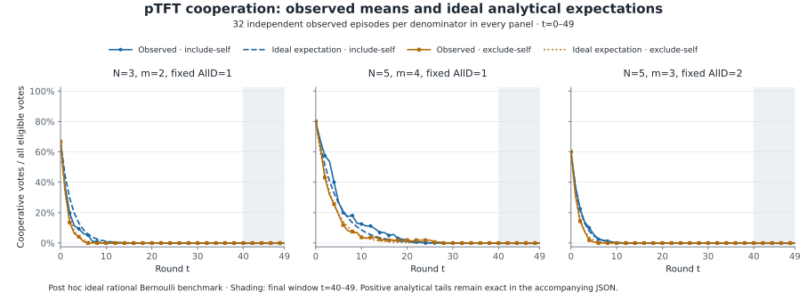

# Study 002 — post hoc exact pTFT benchmark

**Post hoc analytical extension of the existing unfrozen exploratory readout.** The six pTFT cells retain their original 32 independently seeded episodes each. The source contains 221 episodes in total, including 29 deterministic controls. No new episodes, parameter fitting, exclusions or bootstrap draws are introduced.

The ideal rational Bernoulli model has positive expected final-window cooperation in every mixed population, although all 32 observed final windows in each cell were zero. The exact absorption calculation below quantifies how probable that finite-sample event is under this ideal model. Zero observed variance is not zero model variance.

## Observed and analytical trajectories



Cooperation is cooperative votes divided by all eligible votes, including fixed AllD votes. Each observed line averages 32 episodes; the analytical line is an expectation, not a trajectory that each episode must follow. All panels cover t=0,…,49 on the same scale; the shaded region is t=40,…,49. Tiny positive analytical tails may be visually indistinguishable from zero on this scale.

## Episode means and Monte Carlo variability

Let A=(1/50)Σ(t=0…49) c_t. The model column Var(A) is the exact single-episode variance, including covariance across rounds. The empirical s² is the original between-episode sample variance. Model MCSE is sqrt(Var(A)/32). It describes the sampling variability of an average of 32 independent ideal-model episodes; it is neither an empirical variance estimate nor a normal confidence interval. All decimal entries below are approximations; the JSON retains exact fractions.

| Population | Denominator | E[A] | Observed mean | Observed − E[A] | Model Var(A) | Empirical s² | Model MCSE |
|---|---|---:|---:|---:|---:|---:|---:|
| N=3, m=2 | include_self | 0.040000000 | 0.031666667 | -0.0083333333 | 0.00068571422 | 0.00039283154 | ≈0.00462910029135 |
| N=3, m=2 | exclude_self | 0.026666667 | 0.025208333 | -0.0014583333 | 0.00017777778 | 0.00011106631 | ≈0.00235702260396 |
| N=5, m=4 | include_self | 0.079998858 | 0.0945 | 0.014501142 | 0.0024604423 | 0.0035858065 | ≈0.00876862719801 |
| N=5, m=4 | exclude_self | 0.063999964 | 0.067 | 0.0030000362 | 0.0012799693 | 0.0020861935 | ≈0.00632447937282 |
| N=5, m=3 | include_self | 0.030000000 | 0.031 | 0.0010000000 | 0.00023684211 | 0.00022193548 | ≈0.00272053593701 |
| N=5, m=3 | exclude_self | 0.024000000 | 0.023125 | -0.00087500000 | 0.00011076923 | 0.000047209677 | ≈0.00186052101884 |

## Final ten-round windows and absorption

Let B=(1/10)Σ(t=40…49)c_t and T₀ be the first all-D round. Zero cooperation is absorbing, so F40=P(T₀≤40) is exactly the probability that an episode's entire final window is zero. F49=P(T₀≤49) instead describes absorption by the last observed round. For one cell's 32 independent ideal-model episodes, P(all 32 final windows zero)=F40^32. This is a model event probability, not a p-value. A displayed ≈1 can represent a strictly subunit probability; the exact base fraction and exponent remain authoritative.

| Population | Denominator | E[B] | Observed mean | Model Var(B) | Model MCSE |
|---|---|---:|---:|---:|---:|
| N=3, m=2 | include_self | 1.7773880e-8 | 0 | 4.1298039e-9 | ≈0.0000113602980397 |
| N=3, m=2 | exclude_self | 1.2114754e-13 | 0 | 1.2035804e-14 | ≈1.93937848065e-8 |
| N=5, m=4 | include_self | 0.000047460129 | 0 | 0.000015645815 | ≈0.000699236522234 |
| N=5, m=4 | exclude_self | 0.0000030368843 | 0 | 7.7587497e-7 | ≈0.000155711569306 |
| N=5, m=3 | include_self | 1.9930000e-10 | 0 | 2.5765052e-11 | ≈8.97305889612e-7 |
| N=5, m=3 | exclude_self | 1.0903278e-13 | 0 | 9.0990682e-15 | ≈1.68625585299e-8 |

Every cell's empirical final-window sample variance is zero; the model variances above remain positive.

| Population | Denominator | F40 | F49 | P(all 32 final windows zero) | Observed zero windows / n |
|---|---|---:|---:|---:|---:|
| N=3, m=2 | include_self | ≈0.99999986 | ≈1.0000000 | ≈0.999995658998 | 32/32 |
| N=3, m=2 | exclude_self | ≈1.0000000 | ≈1.0000000 | ≈0.999999999942 | 32/32 |
| N=5, m=4 | include_self | ≈0.99973765 | ≈0.99996479 | ≈0.991638924269 | 32/32 |
| N=5, m=4 | exclude_self | ≈0.99997733 | ≈0.99999830 | ≈0.999274676562 | 32/32 |
| N=5, m=3 | include_self | ≈1.0000000 | ≈1.0000000 | ≈0.999999908869 | 32/32 |
| N=5, m=3 | exclude_self | ≈1.0000000 | ≈1.0000000 | ≈0.999999999929 | 32/32 |

## Independent denominator contrasts

Each contrast is include-self minus exclude-self. Equal replicate numbers are labels, not matched pairs: the seed protocol allocates independent condition streams. The model variance of each difference is Var(mean_include)+Var(mean_exclude), with each cell mean variance equal to its single-episode variance divided by 32. The displayed MCSE is the square root of that sum; no covariance is subtracted.

| Population | Outcome | Expected difference | Observed difference | Observed − expected | Model MC variance | Model MCSE |
|---|---|---:|---:|---:|---:|---:|
| n3-m2 | 50-round mean | 0.013333333 | 0.0064583333 | -0.0068749999 | 0.000026984125 | ≈0.00519462463157 |
| n3-m2 | Final-window mean | 1.7773759e-8 | 0 | -1.7773759e-8 | 1.2905675e-10 | ≈0.0000113603145938 |
| n5-m4 | 50-round mean | 0.015998894 | 0.0275 | 0.011501106 | 0.00011688786 | ≈0.0108114690156 |
| n5-m4 | Final-window mean | 0.000044423245 | 0 | -0.000044423245 | 5.1317781e-7 | ≈0.000716364297576 |
| n5-m3 | 50-round mean | 0.0060000000 | 0.007875 | 0.0018750000 | 0.000010862854 | ≈0.00329588444064 |
| n5-m3 | Final-window mean | 1.9919096e-10 | 0 | -1.9919096e-10 | 8.0544221e-13 | ≈8.97464319854e-7 |

## Derivation, provenance and limits

X_t counts cooperating pTFT agents among m reciprocators and N−m fixed defectors, with X₀=m and c_t=X_t/N. Include-self gives X_(t+1)|X_t=x ~ Binomial(m,x/N). Exclude-self gives the sum of independent Binomial(x,(x−1)/(N−1)) and Binomial(m−x,x/(N−1)) variables. The finite transition matrix and moments are computed with rational arithmetic in [study002_markov.py](study002_markov.py).

The conditional mean is λx, with λ=m/N or (m−1)/(N−1). For t≥s, Cov(X_s,X_t)=λ^(t−s)Var(X_s). Summing marginal variances and twice the cross-time covariances, then dividing by (N×window length)², gives each window-mean variance. This is an analytical extension developed after the observed readout, not an additional preregistered prediction.

- Report version: `study002_exact_benchmark@1`; benchmark version: `study002_markov@1`.
- Source [RESULTS.json](RESULTS.json) SHA-256: `b0208013a4bbfe2b5cb59b8b4d767059a08c0c6093c6259d413d680bc5bc0080`.
- Benchmark source SHA-256: `0cf9533cc2380763e6cfc49269d3619e2ff0e7cbee78090324d9ff40b9cb09a1`.
- deterministic study hash: `175140649a108a4f5ea33a4c7a1decf74cdc777a9d47057839a54b7e24ed22eb`
- stochastic study hash: `728392210a4aa437ba2a1f6e4d8be73f99b96b896e596e81a8969c121623754f`
- The generator checks both current study hashes, the condition roster, all 221 episode identities and retained terminal hash formats, and reconciles reported means/variances with per-episode outcomes. It reads the sealed-derived report; it does not independently reverify or replay the original raw ledger chains. The original terminal hashes remain inspectable in RESULTS.json.
- The original [RESULTS.md](RESULTS.md) and its 2,000-draw bootstrap readout remain unchanged, including the reported marginal interval discrepancy. This extension does not replace that readout with normal intervals or significance decisions.
- The benchmark assumes ideal independent rational Bernoulli choices. The existing simulator uses finite-precision PRNG draws and binary-floating-point probabilities. Its sampling semantics, study inputs and source results are unchanged. Neither human nor LLM behavior is inferred.

## Reproduce without new episodes

From the repository root with the committed dependencies installed:

```sh
python studies/002-nipd-sensitivity/generate_exact_benchmark.py --check
python studies/002-nipd-sensitivity/generate_exact_benchmark.py --output artifacts/exact-benchmark/EXACT_PTFT_BENCHMARK
```

`--check` regenerates the JSON, Markdown and SVG in temporary files and compares them byte-for-byte without rewriting existing evidence. Ordinary generation permits fresh outputs or byte-identical no-ops and refuses divergent existing files. SVG generation uses a fixed hash salt, fixed styling and no date metadata.
